# BHEEM — Liberate the Village

A 2D side-scrolling action-platformer brawler built with Phaser 3 + TypeScript.
Fight through four occupied districts — Gate & Outskirts, Market Street, Temple Hill, Chieftain's Hall —
rescue villagers, tear down the Asura banners, then face **Kaalasura**.

## Gameplay

Short clips recorded from the real build (keyboard play in headless Chromium; `npm run media` re-records them). Boss clips use god mode so they show the attack patterns without a game-over.

| Village combat | District liberation |
|---|---|
| 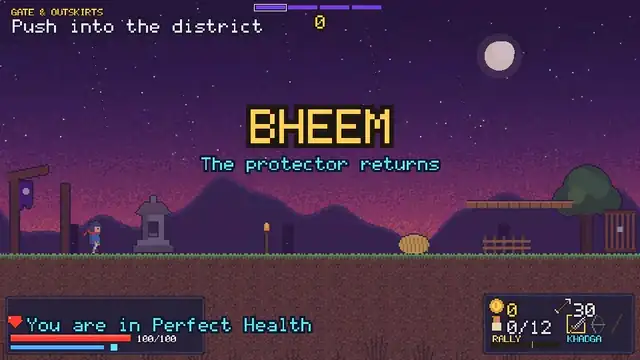 | 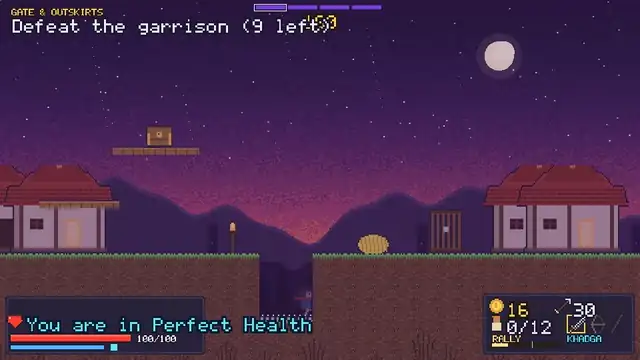 |
| **Kaalasura, four phases** | **Garjana in Sky Citadel** |
| 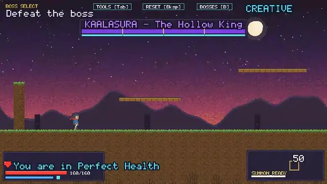 | 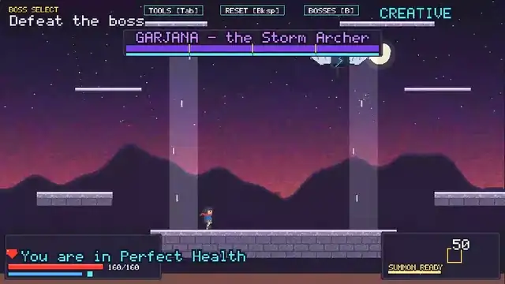 |

**Boss Trial → result → leaderboard**

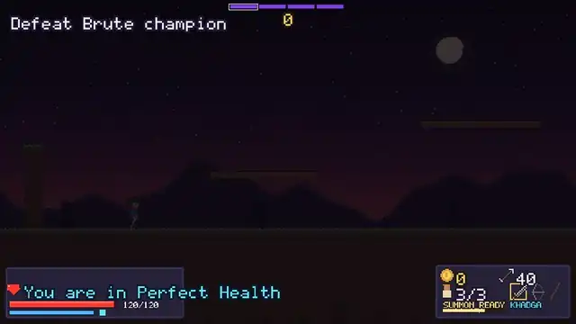

### Screenshots

| | |
|---|---|
| 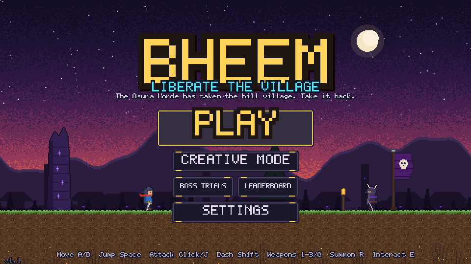 Main menu | 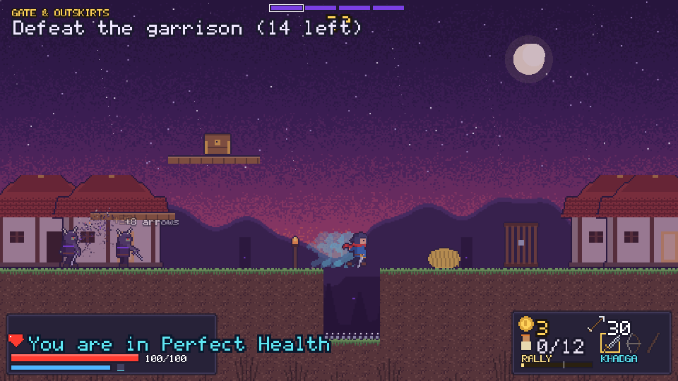 Village, HUD and garrison |
| 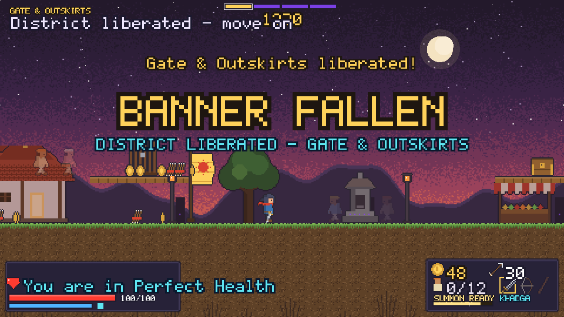 District liberated | 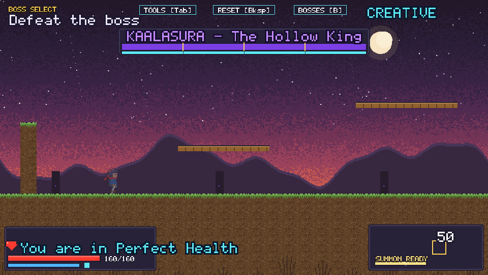 Kaalasura |
| 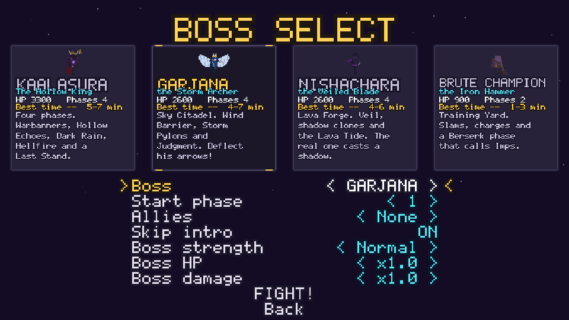 Creative Boss Select with strength presets | 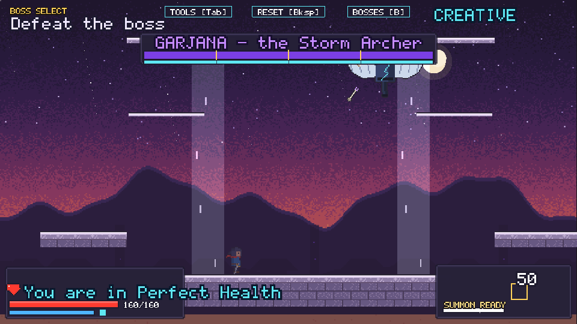 Garjana, Sky Citadel |
| 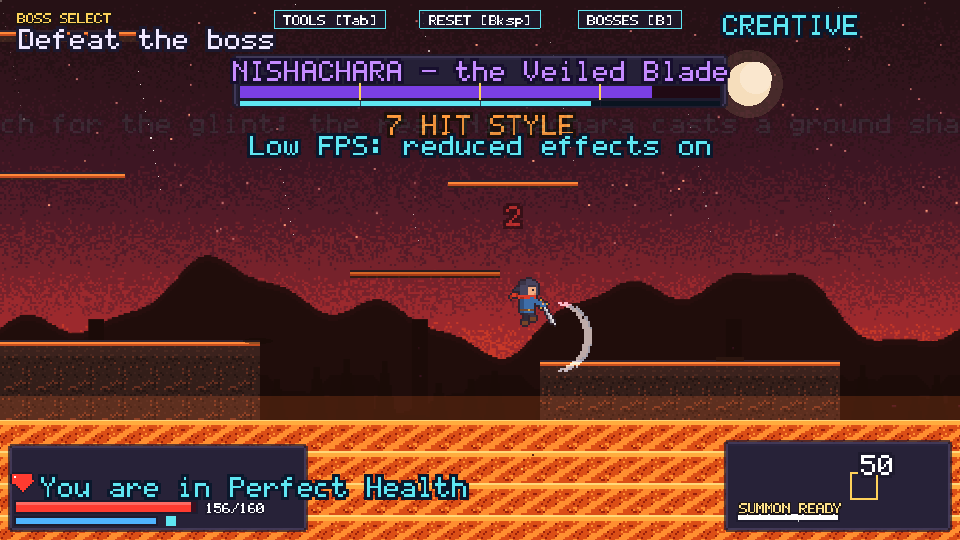 Nishachara, Lava Forge | 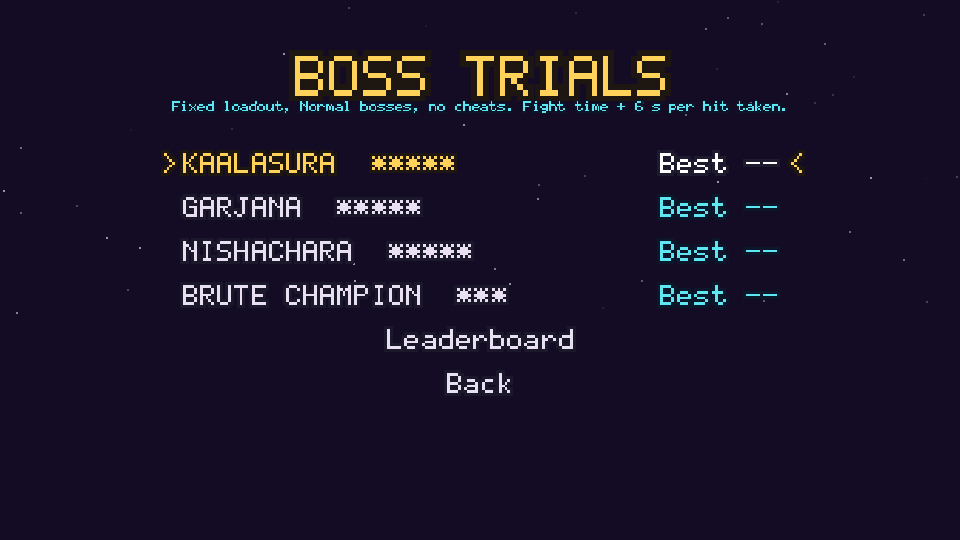 Boss Trials |
| 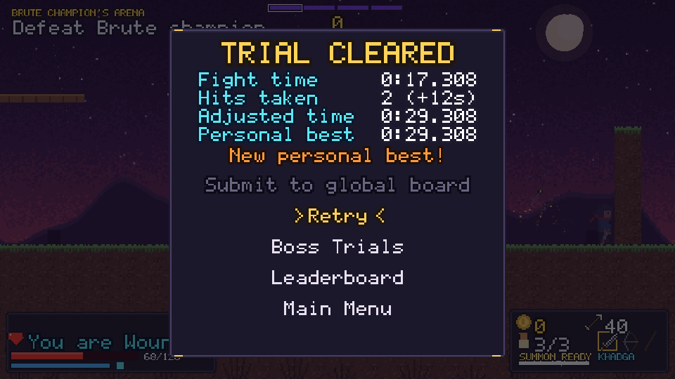 Trial result | 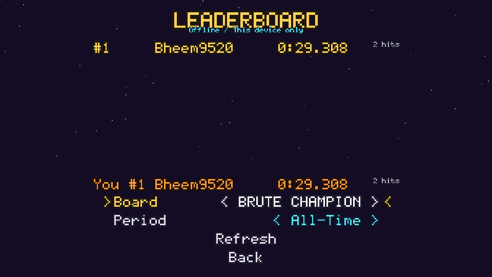 Leaderboard (offline / this device) |

## Modes

- **Story**: Village → four districts → Kaalasura → Victory, with score and a district progress strip.
- **Creative Mode**: Sandbox (Training Yard, Lava Forge, Sky Citadel), Toolbox, Boss Select for Kaalasura, Garjana, Nishachara and the Brute Champion, with Classic / Normal / Legendary strength and HP (×0.25–×4) and damage (×0–×2) sliders.
- **Boss Trials**: fixed loadout, Normal bosses, one life. Score is fight time + 6 s per hit taken. Practice runs (Creative, `?debug`, cheats) are kept locally but never ranked.
- **Leaderboard**: works offline ("This device only"); the optional Cloudflare Worker + D1 backend is in `server/` — see `docs/LEADERBOARD.md`.

## Run

```bash
npm install
npm run dev        # http://localhost:5173
npm run build      # production build in dist/ (static, relative paths)
npx vite preview   # serve the build
```

Requires a WebGL-capable browser.

## Play on a phone

**Hosted (HTTPS):** open the Vercel URL on your phone. Tap **PLAY**; the game tries fullscreen + landscape. Touch controls appear on the first touch and hide again if you use a keyboard, mouse or gamepad (Settings → Touch Controls → *Always show touch* keeps them on).

**Install as an app**
- *Android Chrome:* menu → **Add to Home screen / Install app**. It launches fullscreen in landscape.
- *iPhone Safari:* Share → **Add to Home Screen**. Launch from the icon for the fullscreen experience (Safari tabs cannot hide the address bar or lock orientation). There is no vibration on iPhone.

**Test on your LAN during development**
```bash
npm run dev -- --host        # prints e.g. http://192.168.1.20:5173
```
Open that address on a phone on the same Wi-Fi (or turn it into a QR code with any QR generator, e.g. `npx qrcode-terminal http://192.168.1.20:5173`). Fullscreen, orientation lock and install need HTTPS, so use the Vercel deploy for those.

Phone emulation tests (Playwright, Chromium with Pixel 7 / iPhone 14 landscape viewports and touch):

```bash
npx playwright test --project=pixel7     # or --project=iphone14
npx playwright test tests/e2e/mobile.spec.ts
```

They cover load, tap Play, move, attack, jump, pause, Creative, Boss Select, fight, Reset and no console errors. Emulation is not a real device; check feel on a phone too.

**Touch layout:** left 40% of the screen is a floating joystick (push down to crouch/drop). Right side: ATTACK (tap = sword combo / bolt, hold = bow charge / Thunderclap, drag while holding to aim), JUMP (hold for higher), DASH (cooldown ring), SUMMON (fills with Rally, glows when ready), HOLD/Interact (appears only near shrines, captives, chests). Weapon chips above (tap the active one to cycle). Pause top-right. Settings → Touch Controls: size S/M/L, opacity, left-handed swap, haptics.

## Creative Mode

Main Menu → **CREATIVE MODE**. Everything is unlocked (all weapons, max upgrades, full 12-villager squad, Rally full). Creative never reads or writes Story progress.

- **Sandbox – Training Yard**: 1600 px yard with walls and one-way platforms.
- **Toolbox** (`Tab`, TOOLS button, or pause menu): God Mode, Infinite Prana/Arrows, Instant Rally, No Dash Cooldown, Slow Motion 1× / 0.5× / 0.25×, damage numbers, spawn any enemy (excess beyond 12 is queued), Training Dummy, health/Prana/arrow pickups, Summon Squad, Clear All, move list.
- **Boss Select** (`B`, BOSSES button): Kaalasura, Garjana, Nishachara or the Brute Champion; pick strength, start phase, allies and skip intro. Result panel shows time, damage taken, hits landed and best time.
- **Quick Reset** (`Backspace`, RESET button, or pause menu): full hero restore and a clean field in well under 500 ms.

## Controls

| Action | Keyboard / mouse | Gamepad |
|---|---|---|
| Move | A / D (or arrows) | Left stick |
| Jump | Space / W / Up | A |
| Crouch / drop-through | S (+ Space) | Stick down (+ A) |
| Attack (hold to charge bow / Thunderclap) | J / left click | X / RT |
| Dash | Shift | B / RB |
| Weapons | 1 / 2 / 3, Q or wheel to cycle | D-pad left/up/right, LB |
| Summon squad | R | LT |
| Interact (hold) | E | Y |
| Pause | Esc / P | Start |
| Debug overlay | F3 | — |

All keys can be rebound in Settings.

## Project layout

```
src/config     balance.ts (all tuning), gameConfig, palette, strings
src/core       events, store, save, RNG, time controller
src/logic      pure game rules (damage, economy, loot, summon, boss, district)
src/systems    combat, statuses, targeting, tokens, spawns, summons, districts, loot
src/entities   player, enemies, allies, boss, projectiles, world objects
src/fx         FX, camera director, death FX, parallax
src/scenes     Boot, Preload, MainMenu, Settings, Game, UI, Pause, GameOver, Victory, Shrine
src/assets     procedural pixel art, pixel font, asset manifest
src/level      level schema, reachability, village.level.json
tests/unit     Vitest   ·   tests/e2e  Playwright
```

## Art

All art is generated procedurally at boot. To use a licensed sprite pack instead, set `ART_STYLE` in
`src/config/gameConfig.ts` and register textures in `src/assets/manifest.ts` using the same keys.
See `docs/DECISIONS.md` and `docs/CREDITS.md`.
